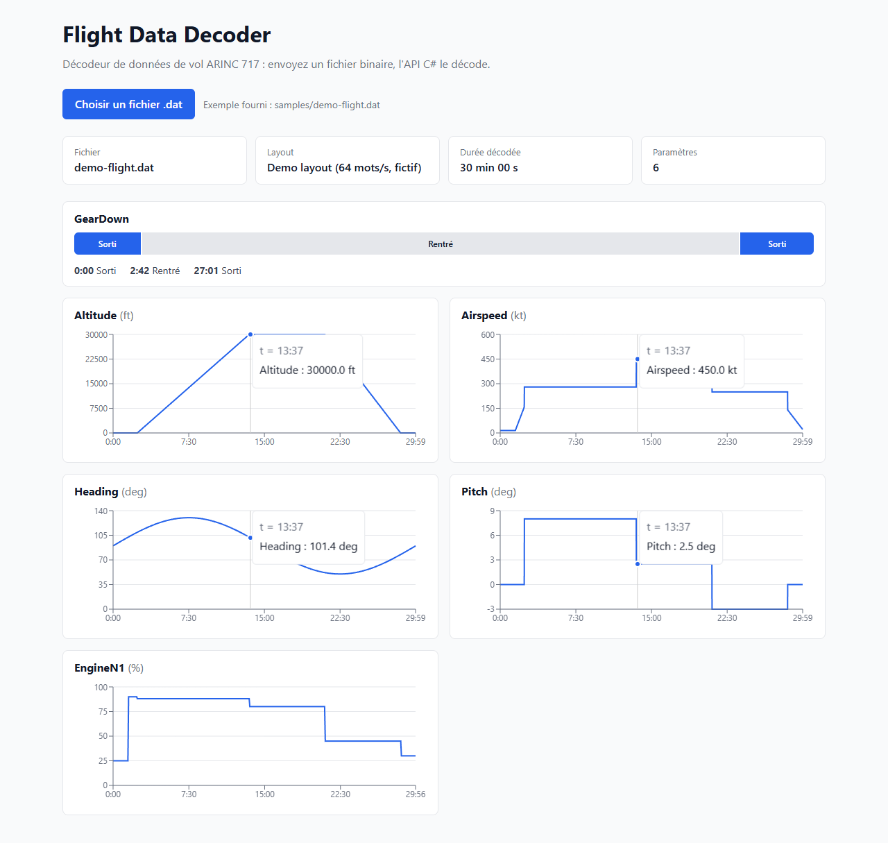

# Flight Data Decoder

[](https://github.com/ScottMichel/flight-data-decoder/actions/workflows/ci.yml)

Un petit décodeur de données de vol : une API en **C# / .NET 10** et un front en **React + TypeScript + Redux Toolkit**.

Pendant un vol, l'avion enregistre ses paramètres (altitude, vitesse, cap…) dans un fichier binaire, au format **ARINC 717**. Ce projet lit ce fichier, le transforme en valeurs lisibles et les affiche sous forme de courbes.

> ⚠️ **Projet d'apprentissage** : les données sont **synthétiques** et le plan de lecture est **fictif**. Les vrais plans sont propriétaires et propres à chaque avion.



## Lancer le projet

Prérequis : le [SDK .NET 10](https://dotnet.microsoft.com/download) et [Node.js](https://nodejs.org/) 20 ou plus.

Dans un premier terminal, l'API :

```bash
dotnet run --project src/FlightDataDecoder.Api
```

Dans un second terminal, le front :

```bash
cd web
npm install
npm run dev
```

Ouvre ensuite http://localhost:5173 et choisis le vol de démonstration fourni : `samples/demo-flight.dat` (30 minutes).

Pour lancer les tests : `dotnet test` (C#) et `npm test` dans `web/` (front).

## Comment ça marche

```
fichier .dat  ──►  nombres de 12 bits  ──►  secondes de vol  ──►  valeurs physiques  ──►  courbes
```

1. Le fichier est une suite de nombres de 12 bits.
2. Des nombres repères (« mots de synchro ») marquent le début de chaque seconde de vol.
3. Un plan de lecture (`layouts/demo-layout.json`) indique où se trouve chaque paramètre et comment le convertir. Exemple : altitude brute 1250 × 8 = 10 000 ft.
4. Le front envoie le fichier à l'API et affiche le résultat.

Pour aller plus loin : [`docs/arinc717.md`](docs/arinc717.md).

## Organisation

| Dossier | Rôle |
|---|---|
| `src/FlightDataDecoder.Core` | La logique de décodage |
| `src/FlightDataDecoder.Api` | L'API REST |
| `src/FlightDataDecoder.Generator` | Génère des vols synthétiques |
| `tests/` | Les tests C# |
| `web/` | Le front React |
